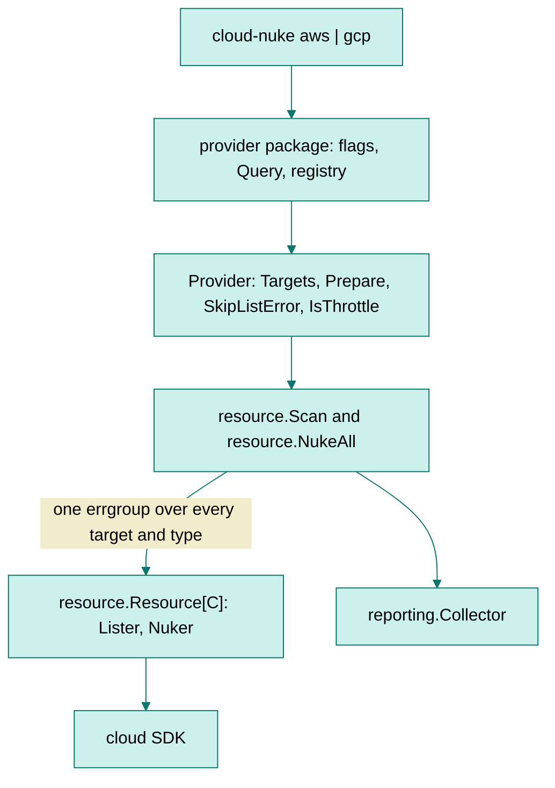

# RFC: One scan and nuke engine for every cloud

**STATUS**: In proposal

**TL;DR:** `cloud-nuke` runs the same scan and nuke loop twice, once per cloud, because the GCP
copy was written by hand from the AWS one. A third cloud would be a third copy. This RFC
proposes a four-method contract that each cloud implements. It also gives the order to land the
five changes in, and reports a prototype running both clouds on one engine.

## Background

### One loop, written twice

AWS and GCP are not the same tool today. `cloud-nuke` deletes 127 AWS resource types, most of
them covered by tests with mocked clients, and three scheduled jobs nuke live AWS accounts, two
of them every three hours and one nightly. It deletes four GCP resource types and runs nothing against GCP in CI, and
`go test -cover ./gcp/...` reports 2.6% of the statements in `gcp/resources`. Whoever adds the
next cloud copies one of those two loops: the tested AWS one or the untested GCP one.

The resource layer is already shared, so a new resource type costs one file: every resource on
both clouds is a `resource.Resource[C]` holding a lister and a nuker. The duplication sits above
it. `aws/aws.go` and `gcp/gcp.go` declare five functions by the same names,
`GetAllResources`, `NukeAllResources`, `nukeAllResourcesInRegion`, `ListResourceTypes` and
`IsNukeable`, with the same two-phase scan, the same shared errgroup and the same batch loop.
The container types (`aws/resource.go` and `gcp/resources/types.go`) and the two command
handlers repeat the same way.

One behavior already differs between the two copies, and one more looks like a difference and
is not. The distinction matters, because the engine has to choose one behavior for every
cloud:

- **cloud-nuke shows a non-fatal GCP result as a hard failure:** the AWS loop sets `Warning` on
  `ResourceDeleted` from `util.IsWarningError`, and the GCP loop never sets it. The engine sets
  it for both, which is a fix.
- **The GCP loop skips identifiers that `IsNukable` rejects and the AWS loop does not, and AWS
  is right:** `IsNukable` reports whether an optional dry-run check said this identifier could
  be deleted, and the scan prints its answer in the found table. a successful EC2 dry run answers with the error `DryRunOperation: Request would
  have succeeded, but DryRun flag is set`. Twenty-one of the 22 AWS verifiers issue such a dry
  run, and 15 of those return that error unchanged rather than mapping it to nil through
  `util.TransformAWSError`. Skipping on
  `IsNukable` would stop deleting EBS volumes, Elastic IPs, key pairs and every IPAM resource.
  The engine therefore keeps the AWS behavior and sends every found identifier to the provider.
  Fixing those 15 verifiers is worth its own change.
### Three defects reproduce on master

Two of the three come from the GCP copy inheriting a region model AWS needs and GCP does not.
The third is in `telemetry`, and reaches a caller on either cloud.

- **A missing credential kills the process:** `gcs-bucket`, `cloud-function` and
  `gcp-pubsub-topic` call `panic()` when their client cannot be built, under a comment claiming
  the adapter recovers it, and nothing in the repository calls `recover()`. Go raises that panic
  inside an `errgroup` goroutine, where the CLI's panic handler cannot reach it, so the binary
  prints a stack trace and dies.
  [#1061](https://github.com/gruntwork-io/cloud-nuke/pull/1061) fixed this in four lines and was
  closed in favor of [#1062](https://github.com/gruntwork-io/cloud-nuke/pull/1062), which was
  itself closed, so the fix never landed.
- **cloud-nuke reports a clean project for every region but the global one:** the GCP loop walks
  regions because the AWS loop does, and `getRegisteredRegionalResources()` returns an empty
  slice. `inspect-gcp --project-id p --region us-central1` prints "No resources found" and exits
  zero without making one API call, so an engineer sweeping a project region by region reads an
  empty project.
- **Reporting a telemetry event before `InitTelemetry` runs dereferences a nil HTTP client:**
  `sendTelemetry` defaults to true while `telemetryClient` is a zero value
  (`telemetry/telemetry.go:9-10`), so `TrackEvent` panics. The CLI always initializes first, so
  this reaches anyone importing `cloud-nuke` as a library: `aws.GetAllResources` reports an
  event on its success path. Reproduced against `origin/master` with a test that calls
  `TrackEvent` and nothing else.

### Two earlier attempts set the size of each change

- **Maintainers closed the big extraction for being big:**
  [#1054](https://github.com/gruntwork-io/cloud-nuke/pull/1054) and
  [#1055](https://github.com/gruntwork-io/cloud-nuke/pull/1055) proposed this same work at 960
  lines across 40 files, and the closing comment reads "Splitting into smaller stacked PRs".
  Only the first slice, [#1056](https://github.com/gruntwork-io/cloud-nuke/pull/1056), landed,
  at 85 lines across 9 files: the `NukeableResource` interface and the removal of the AWS SDK
  from the `resource` package. Nobody wrote the orchestration slice.
- **Maintainers closed [#1062](https://github.com/gruntwork-io/cloud-nuke/pull/1062) over a
  duplicate `ResourceTypeName` in a test fixture:** it carried the GCP region model, panic
  recovery and a new Secret Manager resource across 18 files, and nobody came back to it.

### Use cases

- **Engineers leave resources in GCP test projects that `cloud-nuke` cannot delete:** the four
  supported types are not the ones that leak. What leaks is compute instances, networks,
  firewalls, GKE clusters, service accounts, custom roles, secrets and DNS zones.
- **Whoever adds the next cloud copies the loop they find first:** whichever of the two they
  copy becomes the one this project maintains.
- **An engineer has to be able to trust a region sweep:** a tool that reports a clean project
  when it scanned nothing is worse than a tool that refuses to run.

## Proposed solution

### What a provider implements

A provider answers four questions, and the engine owns everything else: concurrency, batching,
ordering, reporting, waiting out a rate limit.

```go
// Target is one unit of work the engine walks: an AWS region, a GCP project, an
// Azure subscription.
type Target struct {
	ID    string // what the provider recognizes: "us-east-1", a project id
	Label string // what the user sees, including the JSON "region" key
	Last  bool   // defer until every other target has finished nuking
}

type Provider interface {
	// Targets returns the units of work, in scan order.
	Targets() ([]Target, error)

	// Prepare builds the clients for one target and returns its resources in
	// registry order, which is the dependency order the nuke relies on. The
	// returned context is what those resources are given, so a provider can
	// attach per-target values such as an account id.
	Prepare(ctx context.Context, target Target) (context.Context, []NukeableResource, error)

	// SkipListError reports whether a failure to list one type should pass in
	// silence. GCP skips a disabled API; AWS skips nothing. A type the user
	// named on the command line is never skipped silently.
	SkipListError(err error, resourceType string, explicitlyRequested bool) bool

	// IsThrottle reports whether a nuke failure is this cloud's rate limit,
	// which the engine answers by waiting rather than by recording a failure.
	IsThrottle(err error) bool
}
```

Everything each cloud needs sits in one of those four. AWS yields one target per region and
marks `global` as `Last`, because IAM, S3, CloudFront and Route53 deletions can break a
regional delete that is still running. GCP yields exactly one target, the project.



### A GCP location becomes a filter rather than a scope

Every GCP list call takes a project, and the calls that are not project-wide accept a
`locations/-` wildcard. Walking locations the way the AWS loop walks regions therefore costs
more API calls and finds nothing more, so `--region` narrows what the run keeps rather than
what it visits.

Each lister cannot be trusted to apply that filter itself, because a lister that forgets it
widens a run the user narrowed. The GCP adapter, which builds each resource's client and hands
the engine a `NukeableResource`, applies the filter in one place, and every resource type
declares how its location is decided:

```go
const (
	// The identifier is a full resource name carrying /locations/<location>/,
	// so the adapter reads the location out of it and filters.
	LocationFromResourceName LocationScope = iota

	// The lister filters, because the location is on the API's answer and not
	// in the identifier. A GCS bucket is the case.
	LocationAppliedByLister

	// The resource type has no location, such as a Pub/Sub topic. Asking for
	// one location cannot include it, so it refuses to run under a filter
	// rather than deleting project-wide.
	LocationNone
)
```

A resource type declares its scope where it is registered. `NewGcpResource` defaults to
`LocationFromResourceName`, the shape most GCP identifiers have, and a type that is not that
shape says so once:

```go
// gcp/resources/types.go, the interface the adapter satisfies.
LocationScope() LocationScope

// gcp/resources/gcs_bucket.go, and pubsub.go reads LocationNone.
return resources.NewGcpResourceWithLocationScope(r, LocationAppliedByLister)
```

`TestEveryResourceDeclaresALocationScope` reads that method for every registered type and fails
as soon as a new one declares none of the three, so adding one forces the decision. The adapter then calls this for each
identifier it is about to report, and drops the ones that answer false:

```go
// GcpConfig, which every resource receives at Init.
func (c GcpConfig) MatchesLocationFilter(location string) bool
```

No regional registry is left to walk, so no run can report a clean project without calling the
API. The GCP command also refuses `--region global` and `--exclude-region global`, and names a
real GCP location in the error. `global` was the only value that used to work, so a runbook
carrying it over would filter every bucket out and report a clean project.

### Decisions

The first five are the rules a reader must not break, and the rest say why each choice won.

- **The engine never interprets a target** beyond ordering and labeling it: the moment it
  branches on `target.ID == "global"`, it is the AWS loop again.
- **A provider implements four methods and owns its own resources:** anything else a cloud needs
  belongs in its own package.
- **`region` stays the key in JSON output and the column in the table,** because scripts parse
  it. The engine fills it from `Target.Label`, which is a region on AWS and the project on GCP.
- **`resource.Scope` keeps its name and its shape:** it is the per-resource view,
  `{Region, ProjectID}`, and 126 AWS listers take it by signature. `Target` is a separate
  engine-level type, which is what keeps this extraction to 9 files instead of 135.
- **`config.Config` stays flat,** because nesting per cloud would break every existing config
  file. New keys carry a cloud's prefix, and `scripts/check-resource-naming.sh` enforces the
  convention.

- **Extract against AWS, not GCP,** because AWS has the suite and the scheduled nukes while GCP
  has 2.6% statement coverage and nothing in CI. An extraction proven on the cloud without
  tests is not proven.
- **The engine sends every found identifier to the provider, including an identifier that
  `IsNukable` rejected:** the AWS verifiers make `IsNukable` unreliable in the unsafe
  direction, so a pre-delete filter on it would stop deleting 15 resource types. No
  user-visible behavior changes on either cloud, and `IsNukable` keeps its one job, which is
  telling the scan what to report.
- **The engine takes `*reporting.Collector` directly** rather than a hook interface, because
  `reporting` is already provider-neutral and an indirection with one implementation is not
  worth the reader's time.
- **A caller sets the engine's two pauses:** `NukeRequest.BatchPause` and `ThrottlePause`
  default to 10 seconds and 1 minute. Without that the engine cannot be tested at all, which is
  how the loop went untested in both copies.
- **A resource the engine found but cannot convert at the provider boundary is an error:** both
  conversions used to drop it and carry on, which would mean the scan found something that
  nothing then deletes.
- **The engine keys everything per target on `Target.ID`, and `Label` is cosmetic:** keying on
  the label merged two targets that share a label and deleted their resources twice over, which
  `TestTwoTargetsSharingALabelAreNotMerged` now pins.
- **A GCP resource type with no location refuses to run under a location filter:** the
  alternative is to ignore the filter and delete project-wide, which is what the first
  prototype did for three of the four resource types.

### Order of the five changes

Three rules set the order. A change that needs no new target or location type goes first. No
change carries a refactor and a feature together. Nothing that changes what gets deleted on a
cloud lands before that cloud can prove it. Each change is one pull request, and each is small
enough to review in one sitting, because being big is what closed
[#1054](https://github.com/gruntwork-io/cloud-nuke/pull/1054) and an unrelated extra in the
diff is what closed [#1062](https://github.com/gruntwork-io/cloud-nuke/pull/1062).

1. **Stop the GCP panic.** Reopen [#1061](https://github.com/gruntwork-io/cloud-nuke/pull/1061)
   as it stands: three client failures become `InitializationError`, which `resource.Resource`
   returns from its list and nuke calls, so the user reads one error row per resource type
   instead of a stack trace. The adapter recovers a panic as a backstop, and only in `Init`,
   where the client is built: it keeps the recovered value in the message, and a panic from a
   list or a nuke stays visible rather than arriving as an `InitializationError` that hides a
   defect in the resource. Four lines of
   production code, already written and already reviewed once.
2. **Guard `telemetry.TrackEvent` before `InitTelemetry`.** One package, no cloud, no engine.
   It is separate from the first change because packaging unrelated fixes together is what
   closed [#1062](https://github.com/gruntwork-io/cloud-nuke/pull/1062).
3. **Make GCP resources testable.** Each resource takes a narrow interface in place of its
   concrete client, as all 127 AWS resources already do. Its client constructor accepts
   `option.ClientOption`, so an `httptest` server can stand in for the API. A conformance test
   then covers the whole registry: the kebab-case name, the config key wired into
   `allResourceTypes()`, a docs row, `Init` never panicking, and the declared location scope.
4. **Extract the engine and prove it on AWS alone.** `resource/engine.go` plus
   `aws/provider.go`, with GCP keeping its own copy for one change. The proof is that
   `go doc -all ./aws` does not move, the suite fails only what it already failed, and the next
   scheduled nuke of each account deletes what the previous one did.
5. **Move GCP onto the engine, with the single target and the location filter.** This is the
   only change a GCP user sees, so it carries the release note below. Splitting the move from
   the semantics would read nicely in a bisect and would mean shipping a known-false clean
   report on purpose, so it stays one change and no release is cut in the middle of it.

**GCP in CI runs alongside, and blocks what comes after.** A sandbox project, a dry-run
`inspect-gcp` job asserting `summary.general_errors == 0` and a found count above zero, and a
scheduled nuke. The found count is a gate only if the job creates what it counts: it provisions
one bucket and one Pub/Sub topic under a run-scoped name prefix, asserts it finds those, and
deletes them in a deferred step that runs even when the assertion fails. Counting whatever
happens to sit in the project would pass on somebody else's leftovers and fail the first time
the scheduled nuke left the project empty. It is not a predecessor of changes 3 to 5, because those are provable with an
`httptest` server plus one real-project run pasted into the pull request, and because the
project, its billing and its credential are not something an engineer can merge. It is a
precondition of adding GCP resource types, where a mis-scoped nuke reaches instances, networks
and GKE clusters rather than four project-scoped types.

**The GCP resource backlog is its own proposal.** Reviewers approved
[#1066](https://github.com/gruntwork-io/cloud-nuke/pull/1066) (Cloud SQL) and asked two
questions on [#1067](https://github.com/gruntwork-io/cloud-nuke/pull/1067) (Cloud Run) before
both went stale, so both are worth reviving once the resources are testable, and both are
project-scoped so they need no change when GCP moves onto the engine. Everything after them,
compute instances through DNS zones, is a roadmap rather than part of this change.

**Three fixes this change deliberately does not make,** each because it changes what gets
deleted and so needs its own proof: the 15 AWS dry-run verifiers that report success as an
error, the throttled batch that is skipped rather than retried, and a failed `Prepare` that ends
a whole sweep instead of failing one target.

### What this change asks of a reader

- **A maintainer signs off on the series before the engine is written,** rather than on each
  pull request as it arrives. Two earlier attempts died after the first slice landed, so
  agreement on changes 1 to 5 together is what this document is for.
- **The release note for change 5,** which travels in that pull request's body under the
  Release Notes heading `.github/pull_request_template.md` already asks for, drafted: "`cloud-nuke gcp` now honors `--region` and
  `--exclude-region` as GCP locations. `--region global` is refused, since GCP has no location
  by that name and it was previously the only accepted value. The region column and the JSON
  `region` key carry the project id for GCP. Importers of the `gcp` package: `Query.Regions`
  and `Query.ExcludeRegions` are now `Locations` and `ExcludeLocations`, `NukeAllResources` is
  now `NukeProjectResources` and takes a project id, `GetAndInitRegisteredResources` loses its
  region argument, `GlobalRegion` is gone, and `GcpConfig.Region` is replaced by the two
  location fields."
- **The documentation changes with it:** `docs/cli-usage.md` gains the GCP rows for both region
  flags, `docs/configuration.md` the location keys, and `docs/developing.md` a section on
  adding a GCP resource, since otherwise the conformance test is the only thing teaching the
  rule.
- **What would stop this:** if change 3 shows that a GCP resource cannot be put behind a narrow
  interface without rewriting its lister, or if change 4's first scheduled nuke after merge
  deletes a different set than the run before it, the series stops and this document is wrong.

### What the prototype proved

Branch `proto/provider-engine`, built against `master` at `c91668e`. It implements the contract,
moves both clouds onto it, and adds a third cloud that exists only in a test.

Every figure below comes from `go test -cover` and `wc -l` on go1.25.0, the version `mise.toml`
pins and CI installs. A different toolchain counts statements differently and will not
reproduce the coverage rows.

| Measure | Before | After |
| --- | --- | --- |
| `aws/aws.go` | 368 lines | 112 lines, plus a 69-line provider |
| `gcp/gcp.go` | 312 lines | 121 lines, plus a 65-line provider |
| Copies of the orchestration | 2 | 1, at 434 lines |
| Engine tests | none | 16 |
| `gcp` statement coverage | 15.4% | 75.2% |
| `gcp/resources` statement coverage | 2.6% | 17.9% |
| `resource` statement coverage | 92.2% | 94.9% |

Running the prototype settled eight questions about the contract, three of them only after a
review round found the prototype wrong:

- **The AWS package's exported surface does not move:** `go doc -all ./aws` is byte-identical
  before and after, and `go test ./...` fails only the two subtests that fail on `master`. For a
  change that rewrites how 127 AWS resource types are scanned and deleted, that is the claim
  worth checking first.
- **A third cloud needs no engine change:** `resource/engine_test.go` defines a cloud with two
  subscriptions, one of them marked `Last`, implementing the four methods and nothing else. That
  fake has no authentication, no pagination and no rate limiting, so it shows that the contract
  is sufficient for the engine, not that a real cloud is cheap. Its tests assert that the engine walks and labels both subscriptions and
  defers the one marked `Last`. They also assert that it passes over a disabled service unless
  the user named it, reports an unskippable failure while the other subscription keeps scanning,
  and fails the whole run when a provider cannot list its targets or build one client.
- **Registry order survives a scan that finishes out of order:** three resource types whose
  listers answer at different speeds are deleted in the order instances, subnets, network,
  which is the order the registry declares and the order the dependencies require.
- **The nuke still deletes an identifier a verifier could not confirm:** an EC2 dry run answers
  with `DryRunOperation` even when the delete would succeed, so a rejection is not evidence.
  With a pre-delete filter in place, `TestNukeStillDeletesWhatAVerifierCouldNotConfirm` reports
  `expected ["vol-1"], actual nil`.
- **Two targets sharing a display label are not merged:** before the fix, both subscriptions'
  resources were deleted twice over.
- **A lister that ignores the location filter cannot widen a run:** the adapter filters on the
  location in each identifier, and a locationless resource type refuses to run under a filter.
  The registry conformance test then fails on any new resource type that declares neither, and
  the one resource that filters inside its own lister is tested against a fake GCS API, which
  answers `US-CENTRAL1` in upper case and reports a multi-region bucket as `US`.
- **`inspect-gcp` finishes when a credential is missing:** with
  `GOOGLE_APPLICATION_CREDENTIALS` pointing at a missing file, it prints one row per resource
  type in the errors table, reading `failed to create GCS client: dialing: open
  /nonexistent/adc.json`. On `master` the same command dies with a stack trace from inside an
  `errgroup` goroutine.
- **AWS behaves as before:** `go test ./...` fails on exactly the two subtests it fails on at
  `master`, `TestListECSClusters/timeAfterInclusionFilter` and `timeBeforeInclusionFilter`,
  which fail locally, pass in CI and have nothing to do with this change. `go vet`,
  `scripts/check-resource-naming.sh` and `gofmt` report nothing new against `master`.
- **Eleven mutations of the engine shipped green against the first test suite,** including one
  that ignores the resource-type filter, so `--exclude-resource-type` would have stopped working
  silently. Each of those paths now has a test, and each test was checked by making the mutation
  again: the resource-type filter, the config reaching each lister, batching, the throttle
  branch, the deferral of the last target, and both provider round trips.
- **A provider has to unwrap the error the engine hands it:** `Resource.GetAndSetIdentifiers`
  wraps what its lister returned, so a `SkipListError` written with a type assertion instead of
  `errors.As` stops skipping and says nothing. The prototype's test caught this, and the
  existing `isServiceDisabledError` already walks the chain for the same reason.

### Risks

- **An unreachable target fails the whole run:** `Scan` returns the first error `Prepare` gave
  it, so one AWS opt-in region the run has no permission for ends a sweep of thirty. AWS behaves
  this way today for a failed session, so the engine inherits it rather than causing it. The fix
  is its own change: a failed `Prepare` becomes a reported error against that one target.
- **A throttled batch is skipped, not retried.** On a rate limit the engine waits and moves to
  the next batch, so those identifiers are never attempted and never reported as failed. This
  is `master`'s behavior in both loops, copied forward verbatim. Fixing it is worth doing now
  that the engine owns it once for every cloud. That fix changes what gets deleted, so it is its
  own change with its own proof.
- **The public container types hold a pointer to an interface:** `*AwsResource` forces a type
  assertion in each direction at the engine boundary. The prototype keeps those types exactly as
  they are, and dropping the pointer to an interface is worth its own change later.
- **The GCP package's exported surface changes in seven ways,** listed below. The AWS surface,
  which `docs/library-usage.md` documents, does not change.
- **The report's region column carries the project id for GCP** where it carried `global`
  before, so a script selecting GCP rows by `.region == "global"` returns nothing. The JSON
  keys are unchanged.

| Symbol | Change | What a caller does |
| --- | --- | --- |
| `gcp.Query.Regions`, `.ExcludeRegions` | Renamed to `Locations`, `ExcludeLocations` | Rename the field |
| `gcp.NukeAllResources` | Renamed to `NukeProjectResources`, taking a project id | Pass the project id |
| `gcp.GetAndInitRegisteredResources` | Loses its region argument | Drop the argument |
| `gcp.GlobalRegion` | Deleted | Remove the reference; GCP has no global location |
| `resources.GcpConfig.Region` | Replaced by `Locations` and `ExcludeLocations` | Set the location filter instead |
| `gcp.Query.Validate` | No longer defaults an empty region list | Expect a whole-project scan when no location is given |
| `GcpProjectResources.GetRegion("global")` | Keyed by project id now, so this returns nothing | Ask for the project id |

Five of those seven break the build, which is deliberate: the entry point is renamed rather
than quietly given a new meaning, so no caller can pass `regions[0]` as a project id and nuke a
project named after a region. The last two compile unchanged and behave differently, so they are
the two a caller has to read for: `gcp.Query.Validate` no longer fills in a default location
list, and `GetRegion("global")` now answers nothing because the map is keyed by project id.

## Alternatives

- **Fixing each GCP defect where it sits is the cheapest change and the one we keep making:**
  that is what the last nine months of pull requests did. It leaves the one behavior difference
  in place, makes whoever adds the next cloud write the concurrency code a third time, and
  reopens the location question for every new cloud. Rejected because the cost lands on the
  third cloud, which is the one we are about to write.
- **One change doing all of it was tried twice and closed twice:** it would extract the engine,
  move both providers, rename `Scope` and nest the config.
  [#1054](https://github.com/gruntwork-io/cloud-nuke/pull/1054) and
  [#1055](https://github.com/gruntwork-io/cloud-nuke/pull/1055) did that at 960 lines.
- **Making GCP walk locations the way AWS walks regions would fix the silent report with no new
  abstraction:** fill `getRegisteredRegionalResources()` and keep the registry split. Rejected
  because every GCP list call is already project-scoped, so listing each location separately
  would multiply API calls and rate-limit risk while finding the same resources. GCP also has
  more locations than AWS has regions (unverified: read off Google's and AWS's published region
  lists rather than counted from the API).
- **Testable GCP resources alone leave the engine duplicated:** narrow interfaces per resource
  do lift GCP coverage, which is why this stays as the third change above, but they say nothing
  about where the next cloud goes.
- **Nesting `config.Config` per cloud would break every existing config file:** `aws:` and
  `gcp:` each holding their own resource keys removes the chance of a key collision as clouds
  multiply. Rejected for now, because the gain is tidiness and the cost falls on every user; it
  belongs to a major version if it happens at all.

## References

- No GitHub issue is open for the three defects in Background, and the prototype reproduces
  each one (unverified: searched the open issues on 2026-10-20).
- Earlier attempts: [#1054](https://github.com/gruntwork-io/cloud-nuke/pull/1054),
  [#1055](https://github.com/gruntwork-io/cloud-nuke/pull/1055),
  [#1056](https://github.com/gruntwork-io/cloud-nuke/pull/1056),
  [#1061](https://github.com/gruntwork-io/cloud-nuke/pull/1061) and
  [#1062](https://github.com/gruntwork-io/cloud-nuke/pull/1062).
- GCP resources ready to revive: [#1066](https://github.com/gruntwork-io/cloud-nuke/pull/1066),
  [#1067](https://github.com/gruntwork-io/cloud-nuke/pull/1067), and branch
  `jk/gcp-compute-instance-v2`.
- Prototype: branch `proto/provider-engine`.
